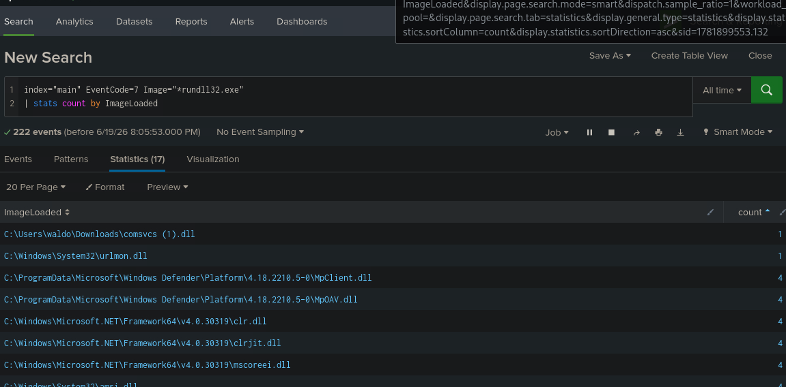
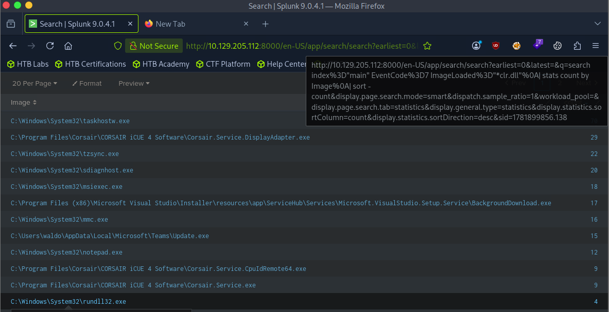
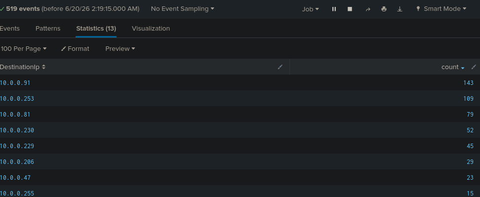
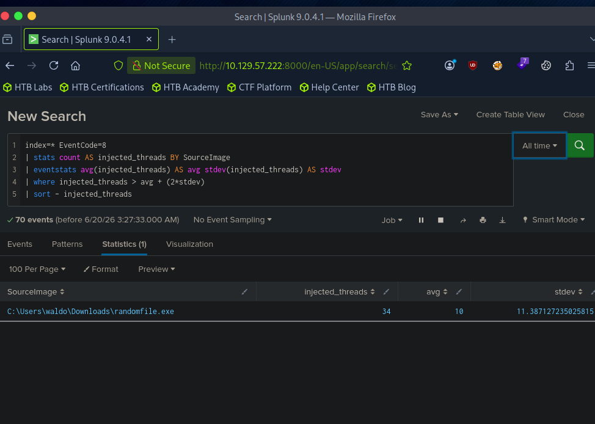
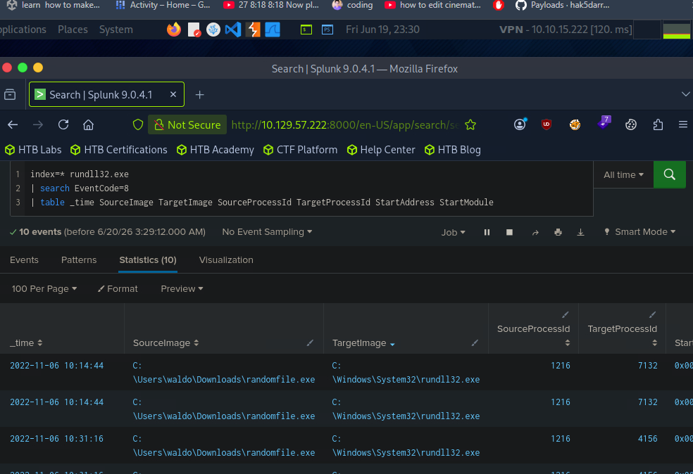

# 🟩 HTB Academy — Splunk for Security Analysts

**Platform:** HackTheBox Academy · **Focus:** SPL for SOC investigation · **Status:** Completed exercises

> Lab answers are partially masked below as a hint, in line with HTB Academy's guidance on not publishing exact graded answers.

---

## What this lab was about

This exercise set is entirely SPL (Search Processing Language) work inside Splunk, built around Sysmon telemetry from a compromised Windows host. It runs two connected investigations. The first traces a full LSASS credential-dumping chain purely from Sysmon event data: which process accessed LSASS's memory, which DLL it abused to do it, and — pivoting further — which command-and-control server it was talking to. The second investigation is a step up in technique: instead of searching for a known indicator, it uses Splunk's `eventstats` command to statistically identify a process injecting an abnormal number of remote threads compared to the rest of the environment, then confirms the finding by tying it back to the same process identified in the first investigation.

---

## Files in this folder

| File | Description |
| [`Splunk_Walkthrough.pdf`](./Splunk_Walkthrough.pdf) | Full illustrated walkthrough of both investigations, with every SPL query and the reasoning behind it. SPL/Sysmon reference on the last page. |
| [`Splunk_Student_Notes.pdf`](./Splunk_Student_Notes.pdf) | Condensed study notes with an SPL & Sysmon index on the first page. |

Both documents share the same Splunk-green / amber accent pair used throughout this folder.

---

## Evidence from the lab

Screenshots of the actual searches, taken while working the module. The HTB answer panel is
cropped out of each one, in line with the masking note above — what's shown is the query and
the result set, which is the part that demonstrates the method.

<figure class="shot" markdown="1">

<figcaption markdown="span">**Which DLLs did `rundll32.exe` load?** `EventCode=7` (Sysmon image load) filtered to `rundll32.exe`, then `stats count by ImageLoaded`. 222 events collapse into 17 distinct DLLs, which is a short enough list to eyeball for the one that doesn't belong.</figcaption>
</figure>

<figure class="shot" markdown="1">

<figcaption markdown="span">**Finding the injection host.** The same pivot applied to `clr.dll` — a .NET runtime load inside a process that has no business running managed code is the tell for C# injection. Sorting descending puts the rare loaders at the top.</figcaption>
</figure>

<figure class="shot" markdown="1">

<figcaption markdown="span">**Where did it call home?** 519 network events grouped by `DestinationIp`. The high-count internal addresses are normal chatter; the question is which low-count destinations repeat on a schedule.</figcaption>
</figure>

<figure class="shot" markdown="1">

<figcaption markdown="span">**Injection without a signature.** This is the search I'd keep. Rather than matching a known-bad name, it counts `EventCode=8` remote threads per source process, then uses `eventstats` to compute the mean and standard deviation across all processes and keeps only those more than two deviations above the mean. The outlier surfaces itself.</figcaption>
</figure>

<figure class="shot" markdown="1">

<figcaption markdown="span">**Confirming the pair.** Once the outlier is known, a `table` of `_time`, source and target image plus both PIDs turns the hit into a timeline you can hand to someone else.</figcaption>
</figure>

---

## Complete walkthrough

### Investigation 1: who dumped LSASS, and how

The chain starts from Sysmon Event ID 10 (ProcessAccess) — logged any time one process opens a handle into another process's memory, which is exactly what a credential-dumping tool does to LSASS. A single SPL query (`EventCode=10 lsass | stats count by SourceImage`) surfaces every process that touched it, and the result is immediately suspicious on its own: `rundll32.exe` has no legitimate reason to be reaching into `lsass.exe`'s memory. Following up with `EventCode=7 Image="*rundll32.exe" | stats count by ImageLoaded` shows exactly which DLL it loaded to do it — `comsvcs.dll`, which exports a `MiniDump` function that was never intended to be invoked this way. Running it via `rundll32.exe comsvcs.dll, MiniDump <lsass PID> output.dmp full` is a well-documented living-off-the-land technique for dumping credentials without ever touching disk with a dedicated tool like Mimikatz — which is precisely why it's worth knowing how to catch in Sysmon data rather than relying on a specific tool's signature.

### Investigation 1: from local dumping to command-and-control

The investigation extends further by looking for a related execution technique on the same host: loading `clr.dll`, the .NET Common Language Runtime, is a strong indicator of an in-memory C# loader (an "execute-assembly" pattern common to post-exploitation frameworks that run code without ever dropping a binary to disk). Tracing suspicious `clr.dll` loads leads back to the same `rundll32.exe` process, and pivoting one more time to Sysmon's network-connection telemetry (Event ID 3) for that process surfaces the two IP addresses of its command-and-control server. Reconstructed end to end, that's a full intrusion chain — credential access, in-memory execution, and C2 — built entirely from three different Sysmon event types tied together by one process image, without ever needing an EDR alert to tell you where to look first.

### Investigation 2: finding process injection without a known signature

The second investigation deliberately doesn't start from a known-bad indicator. Instead, it pulls every Sysmon Event ID 8 (CreateRemoteThread) across the whole environment, counts injected threads per source process, and uses Splunk's `eventstats` command to calculate the average and standard deviation *without collapsing the result set* — which is what makes a statistical outlier filter (`where injected_threads > avg + (2*stdev)`) possible in the first place. That single query surfaces one process injecting far more remote threads than anything else in the environment, and a follow-up query confirms exactly what it injected into: repeated `CreateRemoteThread` events targeting the very same `rundll32.exe` process identified in the first investigation, tying both investigations together as a single technique used twice against the same target process.

---

*Chayan Panchal · [github.com/akatetron](https://github.com/akatetron) · HackTheBox Academy*
